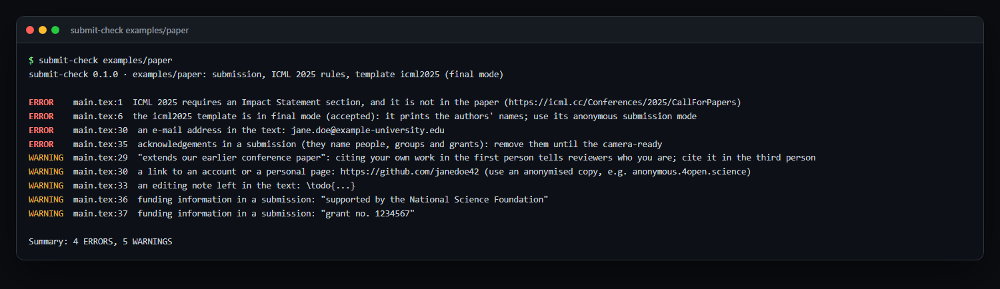

<div align="center">

# submit-check

**Don't get desk-rejected for something a script could have caught.** submit-check reads your LaTeX project and the
compiled PDF, and checks them against the venue's submission rules: nothing gives the authors away, the template is
in the right mode, the required sections are there, the content fits the page limit, the PDF's fonts and metadata are
clean, and no `\todo` is left. It looks through the supplementary zip too (names, paths, `.git`, file metadata,
secrets), checks a camera-ready for what the review version left behind, and before you post the source to arXiv
it lists the comments the world would read.

<a href="https://github.com/zch6a/submit-check/actions/workflows/ci.yml"></a>


<a href="LICENSE"></a>

**English** · [简体中文](README.zh-CN.md)

</div>

---

Every year, papers are desk-rejected for things nobody meant to leave in: the template's camera-ready option still
on, an acknowledgements section naming the lab, "as we showed in our previous work [12]", a GitHub link under the
author's own account, a missing Limitations section at ACL, the author's name in the PDF's metadata, a tenth page.
This is submit-check's real output on [the example paper](examples/paper/main.tex):

<p align="center"></p>

<details>
<summary>The same, as text</summary>

```text
$ submit-check examples/paper
submit-check 0.2.0 · examples/paper: submission, ICML 2025 rules, template icml2025 (final mode)

ERROR    main.tex:1  ICML 2025 requires an Impact Statement section, and it is not in the paper (https://icml.cc/Conferences/2025/CallForPapers)
ERROR    main.tex:6  the icml2025 template is in final mode (accepted): it prints the authors' names; use its anonymous submission mode
ERROR    main.tex:30  an e-mail address in the text: jane.doe@example-university.edu
ERROR    main.tex:35  acknowledgements in a submission (they name people, groups and grants): remove them until the camera-ready
WARNING  main.tex:29  "extends our earlier conference paper": citing your own work in the first person tells reviewers who you are; cite it in the third person
WARNING  main.tex:30  a link to an account or a personal page: https://github.com/janedoe42 (use an anonymised copy, e.g. anonymous.4open.science)
WARNING  main.tex:33  an editing note left in the text: \todo{...}
WARNING  main.tex:36  funding information in a submission: "supported by the National Science Foundation"
WARNING  main.tex:37  funding information in a submission: "grant no. 1234567"

Summary: 4 ERRORS, 5 WARNINGS
```

</details>

## What it checks

| | |
|---|---|
| **Template and mode** | NeurIPS, ICML, ICLR, CVPR/ICCV/WACV, ACL (ARR), ECCV, AAAI, IJCAI and ACM (`acmart`) templates, and whether they are in their anonymous mode (`[final]`, `[preprint]`, `[accepted]`, `\iclrfinalcopy` print the authors; `acmart` needs `anonymous`); the template matches the venue; a camera-ready is not left in review mode |
| **Anonymity** | names in `\author` when nothing hides them; acknowledgements (NeurIPS's `ack` environment is hidden by its template and passes); e-mail addresses; `\thanks`; links to the authors' own code or pages (a link to someone else's library passes; anonymous.4open.science passes); first-person self-citation; funding and grant numbers; the PDF's Author field and user paths in its metadata |
| **The venue's rules** | content pages before the References heading against the limit (submission or camera-ready); required sections: the NeurIPS paper checklist, ICML's Impact Statement, ACL's Limitations section, AAAI's reproducibility checklist; what must not be there (an appendix in an ECCV submission) |
| **The PDF** | Type 3 (bitmap) fonts, fonts not embedded, the paper size (AAAI: US Letter) |
| **Leftovers** | `\todo{}`, `\fixme{}`, TODO / FIXME / TBD in the text, "[citation needed]", "???" (a `\todo` defined to print nothing passes) |
| **Supplementary material** (`--supplementary`) | a .zip or a folder: the authors' names (from `--author` and the paper's `\author` block, also as `jane_doe` or `janedoe`); e-mail addresses; paths with a user name (`/home/jdoe`, `C:\Users\jdoe`); the project's own licence and metadata (`LICENSE`, `setup.py`, `pyproject.toml`, `CITATION.cff`); a W&B entity; a `.git` folder and what its config and history name; run logs (`wandb/`, `mlruns/`); API keys and tokens; a PDF's Author field and text, an Office file's creator, a photo's Artist and GPS tags, a video's artist tag; a zip inside the zip. Copyright headers of copied code and links to GitHub accounts are listed once, to check by hand |
| **Camera-ready** (`--mode camera-ready`) | the author block still "Anonymous"; links still pointing to the anonymised copy (anonymous.4open.science, "available upon acceptance"); cited references by "Anonymous"; "under review" or "Paper ID" in the text; `\linenumbers`; `draft` mode; no title in the PDF's metadata. The template's review mode, the camera-ready page limit and the required sections are checked as before |
| **arXiv** (`--mode arxiv`) | arXiv publishes your source: the comment lines that would be public (the authors' own notes first, not the template's), `\iffalse` blocks, `.tex` files the paper does not use |

Only what prints is checked for leaks: comments and `\iffalse` blocks never reach the PDF (they matter for arXiv, and
`--mode arxiv` reports them).

Supplementary material is where double-blind review often breaks: reviewers download the zip, and the code inside
names its authors in a licence, a path or a git folder. On [the example](examples/supplementary/code):

```text
$ submit-check --supplementary examples/supplementary/code --author "Jane Doe"
submit-check 0.2.0 · examples/supplementary/code: supplementary material (submission)

ERROR    code/LICENSE:3  an author's name: 'Jane Doe'
ERROR    code/README.md:5  an author's name: 'janedoe'
WARNING  code/config.yaml:2  a path with a user name: C:\Users\jdoe (and 1 more place)
WARNING  code/train.py:5  a W&B entity (a user or team name): jdoe-lab
note     code  links to GitHub accounts: huggingface, janedoe42; check none of them is yours

Summary: 2 ERRORS, 2 WARNINGS, 1 note
```

## Moving to another venue: `submit-check move`

A rejected paper goes to the next deadline in another template. `submit-check move paper/ --to icml2025` lists what
the move involves, each with its file and line: the template line to swap; the commands only the old template
defines (`\icmlauthor`, `\iclrfinalcopy`, `\cvprPaperID`, `\institute`, `\ccsdesc`, ...); one column to two
(floats set to `\textwidth` that will overflow a column) or two to one (`figure*` that becomes an ordinary figure);
sections the new venue requires and sections only the old one asked for; the old kit's bibliography style; and the
current PDF's page count against the new limit (a first estimate: the new layout changes it). It changes nothing.

```console
$ submit-check move examples/paper --to neurips2025
submit-check move: from ICML to NeurIPS 2025

Template
  main.tex:6  replace icml2025 with the NeurIPS template in its submission mode (the kit is linked from https://neurips.cc/Conferences/2025/CallForPapers)

Commands of the old template
  main.tex:9  \icmltitlerunning: defined by the ICML template only: delete it (or use the target template's running-title command, if it has one)
  main.tex:12  \twocolumn[: part of the title block the ICML template expects: drop the \twocolumn[...] wrapper and use \maketitle
  main.tex:13  \icmltitle: defined by the ICML template only: use \title{...}
  main.tex:16  \icmlauthor: defined by the ICML template only: move the authors into \author{...} as the target's template asks
  ...

Sections
  add the NeurIPS paper checklist: NeurIPS 2025 requires it (https://neurips.cc/Conferences/2025/CallForPapers)

Bibliography
  main.tex:40  \bibliographystyle{icml2025} comes with the ICML kit: use the style in the NeurIPS kit
```

On 43 of the 50 arXiv sources (those with a known template; each moved to another venue: NeurIPS to ICML, ICML to
NeurIPS, ICLR to ICML, CVPR to ECCV, ACL to NeurIPS, ...): 121 commands of the old template found (27 `\icmlauthor`,
10 `\affiliation`, 7 `\iclrfinalcopy`, CVPR's `\confName` and `\cvprPaperID`, ...), and column notes for every
paper that changes layout. Read through, they were all right; there were too many at first (313, one per float),
so they are now one note per file with a count.

## The rules, and where they come from

Each venue's rules are a small TOML file in [`src/submit_check/rules/`](src/submit_check/rules/), with every value next to
the sentence of the official call for papers it comes from, the page's address, and the date it was read.
`submit-check --list-venues` prints them.

| Venue | Pages (camera-ready) | Not counted | Required | Source (read 2026-11-13) |
|---|---|---|---|---|
| NeurIPS 2025 (`neurips2025`) | 9 (10) | references, checklist, appendix | paper checklist | [call for papers](https://neurips.cc/Conferences/2025/CallForPapers) |
| ICML 2025 (`icml2025`) | 8 (9) | references, impact statement, appendix | Impact Statement | [call for papers](https://icml.cc/Conferences/2025/CallForPapers) |
| ICLR 2026 (`iclr2026`) | 9 (10) | references, appendix, statements | (Reproducibility Statement encouraged) | [author guide](https://iclr.cc/Conferences/2026/AuthorGuide) |
| ACL Rolling Review (`acl-arr`) | 8, long papers | references, limitations, ethics, appendix | Limitations section | [call for papers](https://aclrollingreview.org/cfp) |
| CVPR 2026 (`cvpr2026`) | 8 | references | | [author guidelines](https://cvpr.thecvf.com/Conferences/2026/AuthorGuidelines) |
| ECCV 2026 (`eccv2026`) | 14 | references | no appendix in the main submission | [submission policies](https://eccv.ecva.net/Conferences/2026/SubmissionPolicies) |
| KDD 2026, research track (`kdd2026`) | 8 (9) | references, appendix | ACM template, `anonymous` option | [call for papers](https://kdd2026.kdd.org/research-track-call-for-papers/) |
| IJCAI-ECAI 2026, main track (`ijcai2026`) | 7 | references (2 pages), ethics | | [call for papers](https://2026.ijcai.org/ijcai-ecai-2026-call-for-papers-main-track/) |
| AAAI-26 (`aaai2026`) | 7 | references, reproducibility checklist | reproducibility checklist; US Letter; Type 1/TrueType fonts | [submission instructions](https://aaai.org/conference/aaai/aaai-26/submission-instructions/) |

What each official page says about LLM use, supplementary material and the author response (`policy` in the same
files; each quote checked against the page on 2026-11-14; a dash where the page does not say):

| Venue | LLM use | Supplementary material | Author response |
|---|---|---|---|
| NeurIPS 2025 | follow the NeurIPS LLM policy | May 22, 2025 AoE (a week after the paper), up to 100 MB, one ZIP | one week to respond to the initial reviews |
| ICML 2025 | allowed, to assist in writing or research | no separate deadline | — |
| ICLR 2026 | allowed; significant use described in a separate section on LLM usage (undisclosed: desk rejection) | with the paper | comments on OpenReview, revisions until the end of the discussion period |
| ACL Rolling Review | disclosed in the Responsible NLP Checklist | software and data as two archives, anonymized | — |
| CVPR 2026 | any tools; the authors are responsible | — | a one-page PDF |
| ECCV 2026 | any tools; citing non-existent material leads to rejection | Mar 12, 2026, 11:00 PM CET | a one-page PDF including references |
| AAAI-26 | — | August 4, 2025 (three days after the paper) | October 7-13, 2025 |
| IJCAI-ECAI 2026 | allowed; the authors take full responsibility | with the paper, up to 50 MB | April 7-10, 2026 |
| KDD 2026 | disclosed in the submission form (ACM policy) | — | Apr 4-17, 2026 (February cycle) |

In submission mode the report adds a note where the paper can act on it: ICLR's LLM-usage section when the paper has
none, the checklist or form where ACL and KDD want LLM use disclosed, and ECCV's rule on citing non-existent material
(paper-proof checks the references). `submit-check --list-venues` prints them too.

What an official page does not state (CVPR's camera-ready length, for instance) is not in the rules. Rules change
every year: a pull request with the new value, the sentence and the source is the way to fix one, and adding a venue
is one file ([CONTRIBUTING](CONTRIBUTING.md)).

Without `--venue`, the template chooses the rules (an ACM `acmart` paper needs `--venue`: one class, dozens of venues). For an older template (`neurips_2023`), the venue's newest rules are
used and the report says so; a section those newer rules require is then only a note.

## How accurate it is

Measured on the arXiv sources of 50 well-known papers (the list is in paper-proof's
[`scripts/papers.txt`](https://github.com/zch6a/paper-proof/blob/main/scripts/papers.txt); the sources are fetched for
the measurement and never stored here):

- **False alarms.** These are camera-ready versions, so `--mode camera-ready` should find almost nothing. It finds the
  9 `\todo{}` notes the Stable Diffusion (LDM) source really prints in red; the ReAct source still links its code as
  `anonymous.4open.science/r/ReAct-2268/`; ConvNeXt still cites ConvMixer as "Anonymous, OpenReview 2021". All three
  are real leftovers. The camera-ready checks first also reported Chinchilla's `\usepackage{lineno}` (its
  `\linenumbers` is commented out), its author names joined by `~` as a placeholder, and 5 references by "Anonymous"
  that the papers never cite; fixed. Earlier:
  newer rules were judged too strictly against older papers, coloured text and lower-case "todo"/"XXX" (toggle names,
  ISBN placeholders, table column specs) raised alarms, and a template loaded inside `\iftoggle` (FlashAttention)
  was taken at face value; all fixed.
- **Missed leaks.** Five kinds of leak (own-code link, first-person self-citation, acknowledgements, e-mail, funding),
  each in three wordings, put into the body of each of the 50 papers: **750 of 750 found**, each at its line.
- **Page counting.** On the PDFs of five of them, the References heading was found on the right page each time.
- **arXiv.** On the same sources as arXiv publishes them, `--mode arxiv` points to the authors' own notes, such as
  the Transformer source's "TODO(noam): update re…".
- **Supplementary material.** The code of 15 well-known papers, zipped as GitHub serves it
  ([`scripts/supplementary_repos.txt`](scripts/supplementary_repos.txt)). None is anonymous, so each should give its
  authors away: 14 do, at warning level (the licence or `setup.py` names them: Robin Rombach, Tri Dao, Andrej
  Karpathy, Shunyu Yao, OpenAI; or e-mail addresses and paths such as `/home/mchorse`); DINO's only clue is the
  "Facebook, Inc" copyright headers, which are listed once as a note. Copied code is the hard part: the first run
  reported 1,783 copyright lines, most of them HuggingFace and NVIDIA headers vendored into LoRA and FlashAttention.
  Now the project's own licence and metadata are warnings and other headers are one list; "Copyright License" and
  "Copyright Treaty" from licence texts are no longer read as names.
  [`scripts/measure_supplementary.py`](scripts/measure_supplementary.py) reproduces this.

What it cannot know:
- Whether a link, a self-citation or a dataset gives you away in a way it has no pattern for (a lab-specific tool's
  name, what a demo video shows, a figure with your logo, a user name it is not told). It is a check, not a guarantee
  of anonymity.
- Rules it does not have: workshop formats, journal templates, venues not listed. Then it still checks anonymity,
  leftovers and the PDF.
- The page count of a PDF without a References heading (it says so).

## Install

Python 3.10+. With [uv](https://docs.astral.sh/uv/):

```bash
uvx --from git+https://github.com/zch6a/submit-check submit-check path/to/paper
```

or install it: `uv tool install git+https://github.com/zch6a/submit-check`.

## Use

```bash
submit-check paper/                          # a LaTeX project folder (the main .tex is found), its main.pdf if present
submit-check paper/ --venue neurips2025      # the rules to use (default: from the template)
submit-check paper/ --pdf build/paper.pdf    # the compiled PDF, if it is elsewhere
submit-check paper/ --supplementary supp.zip # the supplementary material too (a .zip or a folder)
submit-check --supplementary code/ --author "Jane Doe"   # only the material, with the names to look for
submit-check paper/ --mode camera-ready      # the camera-ready: page limit, and what the review version left behind
submit-check paper/ --mode arxiv             # before uploading the source to arXiv
submit-check move paper/ --to icml2025       # what moving to another venue's template involves
submit-check paper.pdf --venue icml2025      # a PDF alone: pages, metadata, fonts
submit-check --list-venues                   # every rule, with its source
```

`--format json` gives every finding with its file and line; `--format md` a table for a pull request. Exit codes: 0
nothing at the `--fail-on` level (`error` by default; `warning`, `never`), 1 something found, 2 the input could not be
read.

## On every push (GitHub Action)

For a paper kept in a repository (an Overleaf project synced with GitHub works too):

```yaml
name: submit-check
on: [push, pull_request]
permissions:
  contents: read
jobs:
  check:
    runs-on: ubuntu-latest
    steps:
      - uses: actions/checkout@3d3c42e5aac5ba805825da76410c181273ba90b1 # v7.0.1
        with:
          persist-credentials: false
      - uses: zch6a/submit-check@v0
        with:
          path: paper
          venue: neurips2025   # optional: from the template otherwise
          # pdf: paper/main.pdf
          # supplementary: supplementary/code
```

The report goes to the job summary; the JSON report is the `report` output. Read-only, and it runs nothing from your
repository.

## In your AI agent (Agent Skill)

[`plugin/skills/submit-check/SKILL.md`](plugin/skills/submit-check/SKILL.md) tells Claude Code and other agents that
read Agent Skills to run submit-check before a submission, a camera-ready or an arXiv upload, and how to act on each
kind of finding.

## Privacy

Nothing is sent anywhere: the rules ship with the tool, and the paper and the PDF are read locally. Supplementary
material is read in memory, file by file (at most 20 MB each, 400 MB in all), and nothing in it is extracted or run.
A secret is shown by its first characters only. It reads the
LaTeX project through [paper-proof](https://github.com/zch6a/paper-proof)'s reader (`\input`, comments, `\iffalse`),
whose reference checks it does not use.

## Part of research-kit

One of thirteen open research tools, from reading papers to after publication. All of them, in the order of
the work, with one Claude Code plugin marketplace for their skills: [research-kit](https://github.com/zch6a/research-kit)
· [site](https://zch6a.github.io/research-kit/).

## License

MIT
