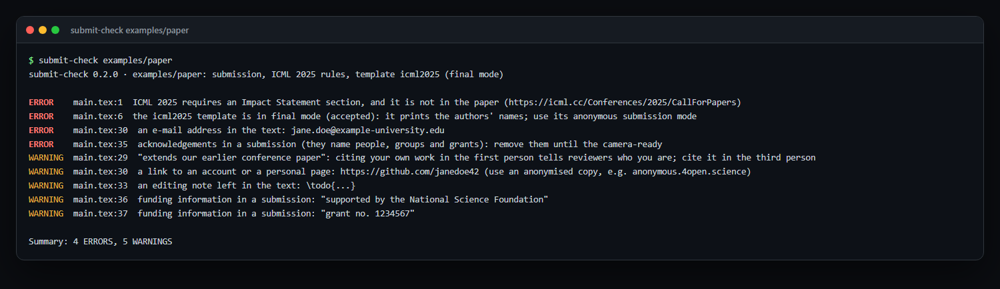

<div align="center">

# submit-check

**别因为一个脚本就能发现的问题被直接拒稿。** submit-check 读你的 LaTeX 工程和编译出的 PDF，对照会议的投稿规定检查：
没有暴露作者身份的地方、模板用的是正确的模式、必需的章节都在、正文没超页数、PDF 的字体和元数据干净、没有残留的 `\todo`。
补充材料的压缩包也查（名字、路径、`.git`、文件元数据、密钥）；交终稿时查评审版留下的东西；往 arXiv 上传源码之前，它会列出那些全世界都能看到的注释。

<a href="https://github.com/zch6a/submit-check/actions/workflows/ci.yml"></a>


<a href="LICENSE"></a>

[English](README.md) · **简体中文**

</div>

---

每年都有论文因为没人故意留下的东西被直接拒稿：模板的终稿选项忘了关、致谢里写着实验室的名字、“如我们之前的工作 [12] 所示”、
挂在作者自己账号下的 GitHub 链接、ACL 投稿缺了 Limitations 一节、PDF 元数据里有作者名、多出来的第十页。
下面是 submit-check 在[示例论文](examples/paper/main.tex)上的真实输出：

<p align="center"></p>

<details>
<summary>同一输出（文字版）</summary>

```text
$ submit-check examples/paper
submit-check 0.2.0 · examples/paper: submission, ICML 2025 rules, template icml2025 (final mode)

ERROR    main.tex:1  ICML 2025 requires an Impact Statement section, and it is not in the paper (https://icml.cc/Conferences/2025/CallForPapers)
ERROR    main.tex:6  the icml2025 template is in final mode (accepted): it prints the authors' names; use its anonymous submission mode
ERROR    main.tex:30  an e-mail address in the text: jane.doe@example-university.edu
ERROR    main.tex:35  acknowledgements in a submission (they name people, groups and grants): remove them until the camera-ready
WARNING  main.tex:29  "extends our earlier conference paper": citing your own work in the first person tells reviewers who you are; cite it in the third person
WARNING  main.tex:30  a link to an account or a personal page: https://github.com/janedoe42 (use an anonymised copy, e.g. anonymous.4open.science)
WARNING  main.tex:33  an editing note left in the text: \todo{...}
WARNING  main.tex:36  funding information in a submission: "supported by the National Science Foundation"
WARNING  main.tex:37  funding information in a submission: "grant no. 1234567"

Summary: 4 ERRORS, 5 WARNINGS
```

</details>

## 查什么

| | |
|---|---|
| **模板与模式** | 认得 NeurIPS、ICML、ICLR、CVPR/ICCV/WACV、ACL（ARR）、ECCV、AAAI、IJCAI 和 ACM（`acmart`）的模板，看它们是否处在匿名模式（`[final]`、`[preprint]`、`[accepted]`、`\iclrfinalcopy` 都会印出作者）；模板与会议是否一致；终稿是否还停在评审模式 |
| **匿名** | 没有东西隐藏时 `\author` 里的真名；致谢（NeurIPS 的 `ack` 环境由模板自动隐藏，不报）；邮箱；`\thanks`；指向作者自己代码或主页的链接（指向别人的库不报，anonymous.4open.science 不报）；第一人称自引；资助与基金号；PDF 元数据里的作者名和带用户名的路径 |
| **会议规定** | References 之前的正文页数对照上限（投稿或终稿）；必需章节：NeurIPS 的 paper checklist、ICML 的 Impact Statement、ACL 的 Limitations、AAAI 的复现清单；不许出现的内容（ECCV 投稿正文里的附录） |
| **PDF** | Type 3（位图）字体、未嵌入的字体、纸张大小（AAAI：US Letter） |
| **残留** | `\todo{}`、`\fixme{}`、正文里的 TODO / FIXME / TBD、“[citation needed]”、“???”（被定义成什么都不印的 `\todo` 不报） |
| **补充材料**（`--supplementary`） | .zip 或文件夹：作者的名字（来自 `--author` 和论文的 `\author`，也认 `jane_doe`、`janedoe` 这类写法）；邮箱；带用户名的路径（`/home/jdoe`、`C:\Users\jdoe`）；项目自己的许可证和元数据（`LICENSE`、`setup.py`、`pyproject.toml`、`CITATION.cff`）；W&B 的 entity；`.git` 文件夹及其配置和历史里的名字；运行日志（`wandb/`、`mlruns/`）；API 密钥和令牌；PDF 的 Author 字段和正文、Office 文件的创建者、照片的 Artist 和 GPS 信息、视频的作者标签；压缩包里套的压缩包。复制来的代码里的版权声明和 GitHub 账号链接只汇总列一次，由你自己核对 |
| **终稿**（`--mode camera-ready`） | 作者栏还是 “Anonymous”；链接还指向匿名副本（anonymous.4open.science、“available upon acceptance”）；被引用的参考文献作者是 “Anonymous”；正文里有 “under review” 或 “Paper ID”；`\linenumbers`；`draft` 模式；PDF 元数据里没有标题。模板是否还在评审模式、终稿页数和必需章节照旧检查 |
| **arXiv**（`--mode arxiv`） | arXiv 会公开你的源码：会被公开的注释行（先列作者自己的笔记，不是模板的）、`\iffalse` 块、论文没用到的 `.tex` 文件 |

查泄露只看会印出来的内容：注释和 `\iffalse` 块不会进 PDF（它们对 arXiv 才要紧，由 `--mode arxiv` 报告）。

双盲评审常常在补充材料上露馅：审稿人下载压缩包，里面的代码在许可证、路径或 `.git` 文件夹里写着作者是谁。在[示例](examples/supplementary/code)上：

```text
$ submit-check --supplementary examples/supplementary/code --author "Jane Doe"
submit-check 0.2.0 · examples/supplementary/code: supplementary material (submission)

ERROR    code/LICENSE:3  an author's name: 'Jane Doe'
ERROR    code/README.md:5  an author's name: 'janedoe'
WARNING  code/config.yaml:2  a path with a user name: C:\Users\jdoe (and 1 more place)
WARNING  code/train.py:5  a W&B entity (a user or team name): jdoe-lab
note     code  links to GitHub accounts: huggingface, janedoe42; check none of them is yours

Summary: 2 ERRORS, 2 WARNINGS, 1 note
```

## 规则及其出处

每个会议的规则是 [`src/submit_check/rules/`](src/submit_check/rules/) 里的一个 TOML 小文件，每个值旁边都引着官方投稿说明的原句，
并注明网址和读取日期。`submit-check --list-venues` 会全部列出。

| 会议 | 页数（终稿） | 不计入 | 必需 | 出处（2026-11-13 读取） |
|---|---|---|---|---|
| NeurIPS 2025（`neurips2025`） | 9（10） | 参考文献、checklist、附录 | paper checklist | [call for papers](https://neurips.cc/Conferences/2025/CallForPapers) |
| ICML 2025（`icml2025`） | 8（9） | 参考文献、impact statement、附录 | Impact Statement | [call for papers](https://icml.cc/Conferences/2025/CallForPapers) |
| ICLR 2026（`iclr2026`） | 9（10） | 参考文献、附录、各类声明 | （鼓励写 Reproducibility Statement） | [author guide](https://iclr.cc/Conferences/2026/AuthorGuide) |
| ACL Rolling Review（`acl-arr`） | 8（长文） | 参考文献、limitations、ethics、附录 | Limitations 一节 | [call for papers](https://aclrollingreview.org/cfp) |
| CVPR 2026（`cvpr2026`） | 8 | 参考文献 | | [author guidelines](https://cvpr.thecvf.com/Conferences/2026/AuthorGuidelines) |
| ECCV 2026（`eccv2026`） | 14 | 参考文献 | 投稿正文里不能有附录 | [submission policies](https://eccv.ecva.net/Conferences/2026/SubmissionPolicies) |
| KDD 2026 研究赛道（`kdd2026`） | 8（9） | 参考文献、附录 | ACM 模板，`anonymous` 选项 | [call for papers](https://kdd2026.kdd.org/research-track-call-for-papers/) |
| IJCAI-ECAI 2026 主赛道（`ijcai2026`） | 7 | 参考文献（2 页）、ethics | | [call for papers](https://2026.ijcai.org/ijcai-ecai-2026-call-for-papers-main-track/) |
| AAAI-26（`aaai2026`） | 7 | 参考文献、复现清单 | 复现清单；US Letter；Type 1/TrueType 字体 | [submission instructions](https://aaai.org/conference/aaai/aaai-26/submission-instructions/) |

官方页面没写的（比如 CVPR 终稿页数）规则里就没有。规则每年都变：修正一条只需一个改值、附原句和出处的 PR；加一个会议就是加一个文件（见 [CONTRIBUTING](CONTRIBUTING.md)）。

不指定 `--venue` 时由模板决定用哪套规则（ACM 的 `acmart` 要用 `--venue`：一个模板对应几十个会议）。模板较旧（如 `neurips_2023`）时用该会议最新的规则并在报告里说明；这时新规则要求的章节缺失只给提示。

## 准确度

在 50 篇知名论文的 arXiv 源码上测量（清单见 paper-proof 的 [`scripts/papers.txt`](https://github.com/zch6a/paper-proof/blob/main/scripts/papers.txt)；测量时取源码，不存进本仓库）：

- **误报。** 这些都是终稿，`--mode camera-ready` 应该几乎什么都不报。它报了 Stable Diffusion（LDM）源码里确实以红字印出的 9 处 `\todo{}`；ReAct 的源码里代码链接还是 `anonymous.4open.science/r/ReAct-2268/`；ConvNeXt 引用 ConvMixer 时作者还写着 “Anonymous, OpenReview 2021”。这三处都是真的遗留。
  终稿检查第一版还把 Chinchilla 的 `\usepackage{lineno}`（它的 `\linenumbers` 被注释掉了）、用 `~` 连起来的作者名，以及论文没有引用的 5 条 “Anonymous” 参考文献报了出来，已修正。更早修掉的：拿新规则苛求旧论文；彩色文字和小写的 “todo”/“XXX”（toggle 名、ISBN 占位、表格列格式）误报；在 `\iftoggle` 里加载的模板（FlashAttention）被当真。
- **漏报。** 把五类泄露（自己代码的链接、第一人称自引、致谢、邮箱、资助）各三种写法插进 50 篇论文的正文：**750 处全部查出**，且都在插入的那一行。
- **页数。** 其中 5 篇的 PDF 上，References 标题每次都找对了页。
- **arXiv。** 在 arXiv 公开的这些源码上，`--mode arxiv` 指出的是作者自己的笔记，比如 Transformer 源码里的 “TODO(noam): update re…”。
- **补充材料。** 15 篇知名论文的代码，按 GitHub 提供的压缩包原样检查（清单见 [`scripts/supplementary_repos.txt`](scripts/supplementary_repos.txt)）。它们都不是匿名的，所以每一份都应该暴露作者：14 份在警告级别查出（许可证或 `setup.py` 写着 Robin Rombach、Tri Dao、Andrej Karpathy、Shunyu Yao、OpenAI 等，或者是邮箱和 `/home/mchorse` 这样的路径）；DINO 唯一的线索是源文件里 “Facebook, Inc” 的版权声明，汇总成一条提示。难点在复制来的代码：第一版报了 1783 条版权行，大多是 LoRA 和 FlashAttention 里附带的 HuggingFace、NVIDIA 文件头。现在项目自己的许可证和元数据给警告，其余文件头汇总成一条；许可证正文里的 “Copyright License”、“Copyright Treaty” 不再被当成名字。[`scripts/measure_supplementary.py`](scripts/measure_supplementary.py) 可以复现。

它不知道的：
- 它没有对应模式的泄露方式（实验室专用工具的名字、演示视频的画面、带着你们 logo 的图、没告诉它的用户名）。这是检查，不是匿名的保证。
- 它没有的规则：研讨会格式、期刊模板、没列出的会议。这时仍会检查匿名、残留和 PDF。
- 没有 References 标题的 PDF 的页数（会说明）。

## 安装

需要 Python 3.10+。用 [uv](https://docs.astral.sh/uv/)：

```bash
uvx --from git+https://github.com/zch6a/submit-check submit-check path/to/paper
```

或者安装：`uv tool install git+https://github.com/zch6a/submit-check`。

## 用法

```bash
submit-check paper/                          # LaTeX 工程文件夹（自动找主文件），同名 PDF 在的话一起查
submit-check paper/ --venue neurips2025      # 指定规则（默认看模板）
submit-check paper/ --pdf build/paper.pdf    # PDF 在别处时
submit-check paper/ --supplementary supp.zip # 连补充材料一起查（.zip 或文件夹）
submit-check --supplementary code/ --author "Jane Doe"   # 只查补充材料，并告诉它要找的名字
submit-check paper/ --mode camera-ready      # 终稿：按终稿页数查，并找评审版留下的东西
submit-check paper/ --mode arxiv             # 上传 arXiv 源码之前
submit-check paper.pdf --venue icml2025      # 只有 PDF：页数、元数据、字体
submit-check --list-venues                   # 列出每条规则和出处
```

`--format json` 输出每个问题的文件和行号；`--format md` 输出可贴进 PR 的表格。退出码：0 没有达到 `--fail-on` 级别的问题（默认 `error`；也可 `warning`、`never`），1 有问题，2 输入读不了。

## 每次推送自动检查（GitHub Action）

论文放在仓库里时（和 GitHub 同步的 Overleaf 项目也行）：

```yaml
name: submit-check
on: [push, pull_request]
permissions:
  contents: read
jobs:
  check:
    runs-on: ubuntu-latest
    steps:
      - uses: actions/checkout@3d3c42e5aac5ba805825da76410c181273ba90b1 # v7.0.1
        with:
          persist-credentials: false
      - uses: zch6a/submit-check@v0
        with:
          path: paper
          venue: neurips2025   # 可选，不写就看模板
          # pdf: paper/main.pdf
          # supplementary: supplementary/code
```

报告写进任务摘要，JSON 报告是 `report` 输出。只需读权限，不运行你仓库里的任何东西。

## 在 AI 助手里用（Agent Skill）

[`plugin/skills/submit-check/SKILL.md`](plugin/skills/submit-check/SKILL.md) 让 Claude Code 等支持 Agent Skills 的助手在投稿、交终稿或上传 arXiv 之前运行 submit-check，并知道每类问题该怎么处理。

## 隐私

不发送任何内容：规则随工具一起发布，论文和 PDF 都在本地读取。补充材料在内存里逐个文件读取（每个最多 20 MB，总共最多 400 MB），不解压到磁盘，也不运行其中任何东西。密钥只显示开头几个字符。LaTeX 工程通过 [paper-proof](https://github.com/zch6a/paper-proof) 的读取器读取（`\input`、注释、`\iffalse`），不使用它联网核查参考文献的部分。

## 属于 research-kit

这是 13 个开源科研工具之一，覆盖从读论文到论文发表之后。全部工具按科研流程的介绍，以及安装它们技能的 Claude Code 插件市场，见 [research-kit](https://github.com/zch6a/research-kit) · [网站](https://zch6a.github.io/research-kit/)。

## 许可证

MIT
